# Configuración de un firewall pfSense en VirtualBox

En esta práctica de **Seguridad y Alta Disponibilidad (ASIR)** he instalado pfSense CE 2.9.0 en VirtualBox y he configurado una red con tres zonas: WAN, LAN y DMZ. Quería practicar cómo separar las redes y controlar el tráfico que puede pasar entre ellas.

## Herramientas

- pfSense Community Edition 2.9.0
- Oracle VirtualBox
- TCP/IP, DHCP y SSH
- Firewall Rules y Network Segmentation

## Configuración de red

| Interfaz | Dirección | Uso |
| --- | --- | --- |
| WAN (`em0`) | `10.0.2.15/24` (DHCP) | Salida por NAT de VirtualBox |
| LAN (`em2`) | `192.168.50.1/24` | Red de usuarios |
| DMZ (`em1`) | `10.0.0.1/24` | Red destinada a servidores |

En VirtualBox dejé el adaptador 1 en NAT, el 2 en la red interna `DMZ` y el 3 en la red interna `LAN`. Para entrar al panel web desde mi ordenador cambié temporalmente el adaptador de LAN a Host-only; después volví a la configuración de red interna para las capturas de la PAC.

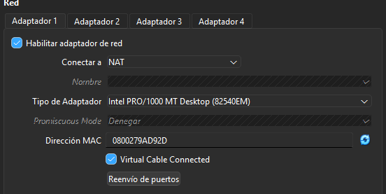
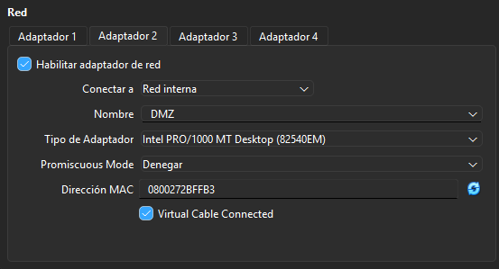
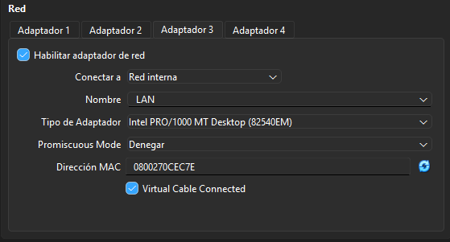

## Instalación y asignación de interfaces

Después de instalar pfSense asigné `em0` a WAN, `em2` a LAN y `em1` a OPT1 (que renombré como DMZ). En la consola comprobé que las tres interfaces tenían las IP previstas.

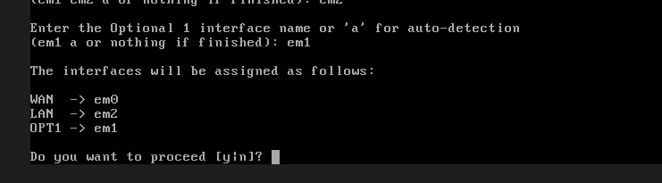
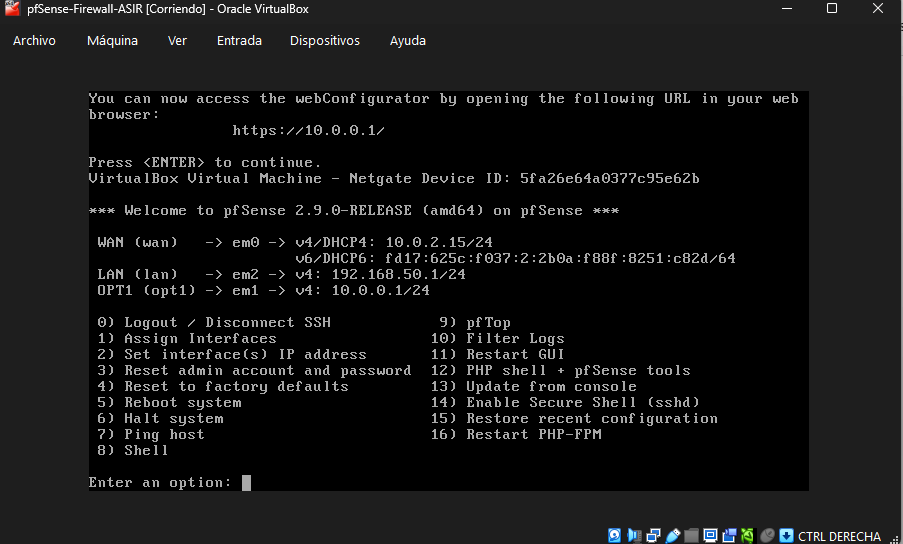
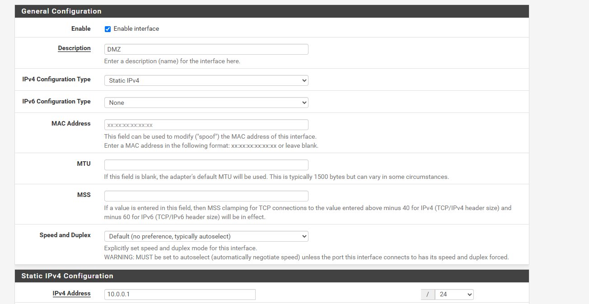

## General Setup

En el panel web configuré el hostname `MedialdeaDominguez`, los DNS de Google (`8.8.8.8` y `8.8.4.4`) y desactivé **Override DNS**. Mantuve el acceso al administrador mediante HTTPS.

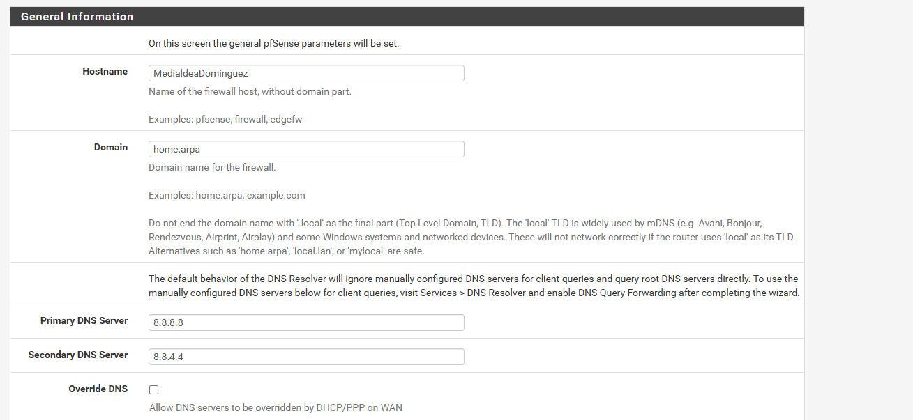

También revisé la opción **Block private networks and loopback addresses** de la interfaz WAN. En la captura aparece activada. Al utilizar NAT en VirtualBox, conviene revisar esta opción si aparecen problemas de conectividad con redes privadas.

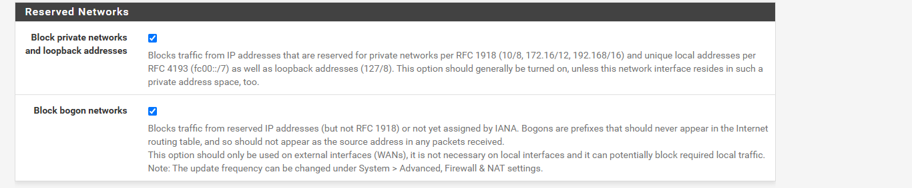

## DHCP Static Mapping

En la LAN habilité DHCP con el rango `192.168.50.100`–`192.168.50.199`. Después creé una reserva fuera de ese rango, con estos datos de la práctica:

- MAC: `08:00:27:72:65:E7`
- IP reservada: `192.168.50.10`
- Descripción: `MedialdeaDominguezEduardo`

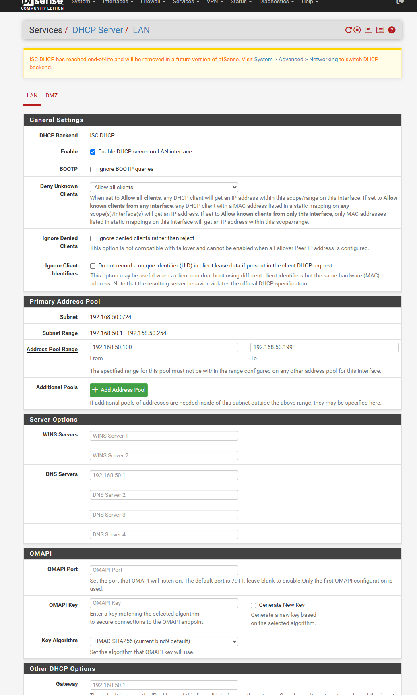
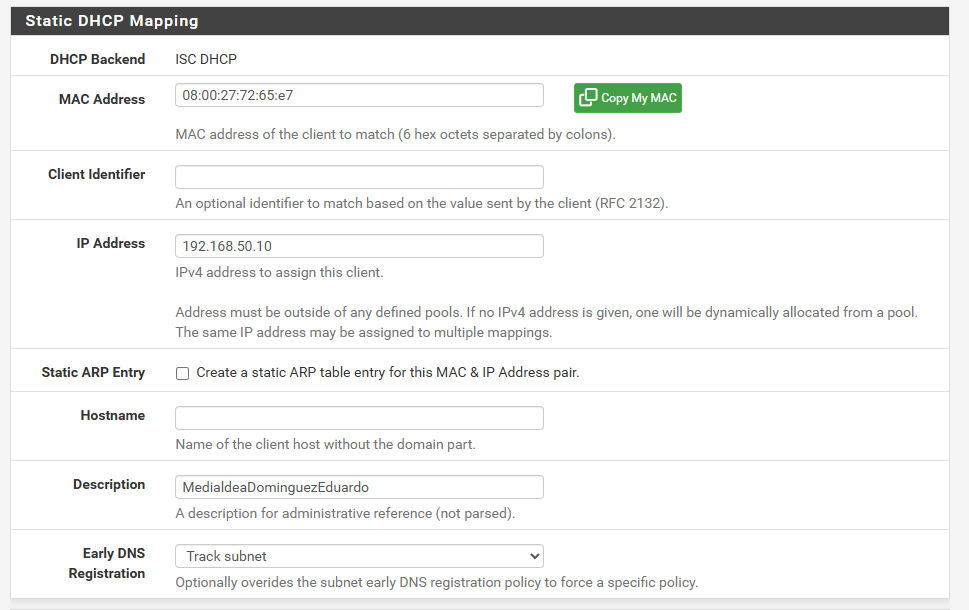

## Regla SSH de LAN a DMZ

Creé una regla **Pass** en la interfaz **LAN**, con IPv4 y TCP, para permitir el acceso desde `192.168.50.10` al servidor `10.0.0.50` de la DMZ por el puerto **22 (SSH)**.

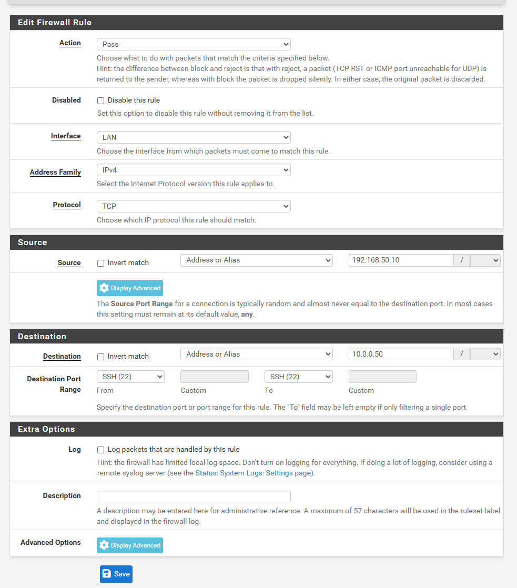

## Comprobaciones y pendientes

He podido acceder al panel de pfSense desde el equipo anfitrión a través de Host-only, y he comprobado las interfaces y los formularios de configuración.

**Pendiente:** probar con un cliente que recibe la reserva DHCP y verificar una conexión SSH real al servidor Ubuntu `10.0.0.50`. La regla está configurada, pero no he documentado una conexión SSH satisfactoria.

## Qué he aprendido

Esta práctica me ha servido para entender mejor la separación entre WAN, LAN y DMZ, configurar reservas DHCP y definir reglas de tráfico específicas entre equipos y redes.
